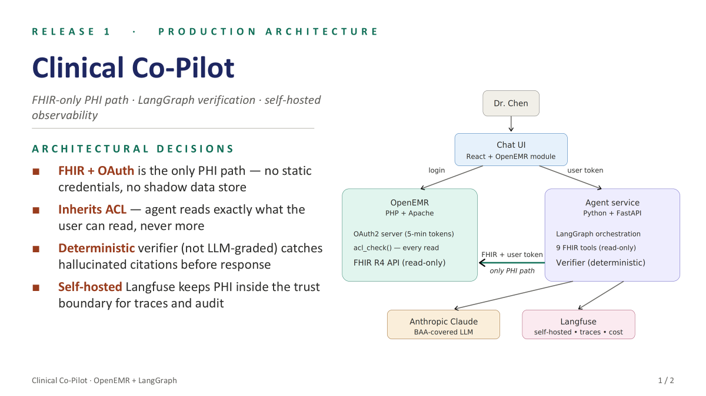
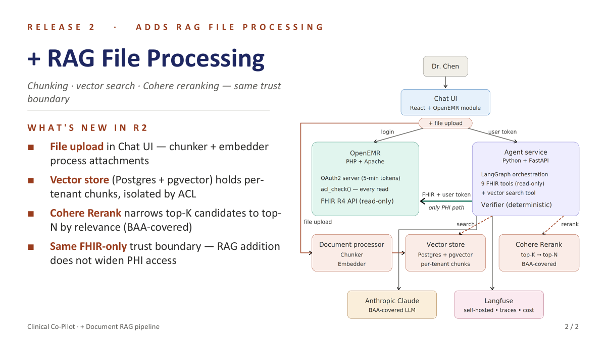

# Architecture diagrams (Releases R1 / R2 / R3)

Slide-deck exports of the production-shape architecture, kept here so future-you (or a grader, or a teammate) has the visual reference. Each diagram describes the **target shape** — the as-built code in this repo doesn't match every box. The "What's shipped vs. aspirational" notes below call out the gaps so nobody assumes Next.js 15 + pgvector + OpenEMR-OAuth are running today.

The authoritative as-built view lives in [W2_ARCHITECTURE.md](../../../W2_ARCHITECTURE.md) and [PATIENT_DASHBOARD_MIGRATION.md](../../../PATIENT_DASHBOARD_MIGRATION.md).

## R1 — Production architecture (FHIR + OAuth, LangGraph verification)

The baseline Clinical Co-Pilot. Dr. Chen logs into the React Chat UI, OpenEMR (PHP+Apache) is the OAuth2 server and the only PHI source, the agent service (Python+FastAPI) runs LangGraph orchestration with 9 read-only FHIR tools and a deterministic verifier, calls a BAA-covered Anthropic Claude, and emits traces to a self-hosted Langfuse.

**What's shipped:**
- React + TypeScript Chat UI ([ui/](../../../ui))
- Python + FastAPI agent service with LangGraph ([agent/agents/outer_graph.py](../../../agent/agents/outer_graph.py))
- Deterministic two-pass verifier ([agent/verifier.py](../../../agent/verifier.py))
- BAA-covered Anthropic Claude
- Langfuse observability with trace_id per turn ([agent/observability.py](../../../agent/observability.py))

**What's aspirational vs. shipped:**
- Diagram shows OpenEMR (PHP+Apache) as the OAuth2 server and PHI source. **Shipped:** session-based auth + MFA over a synthetic FHIR mirror in-process ([agent/dashboard_fhir.py](../../../agent/dashboard_fhir.py), [agent/auth.py](../../../agent/auth.py)). The agent's "FHIR tools" read SQLite-backed demo data ([agent/demo_data.py](../../../agent/demo_data.py)) shaped like FHIR resources, not a real OpenEMR FHIR R4 endpoint.
- Diagram shows `acl_check()` per FHIR read on the OpenEMR side. **Shipped:** assignment-based RBAC enforced in the agent service ([agent/rbac.py](../../../agent/rbac.py)) before every tool call, audit-logged.
- Real OpenEMR Docker integration was attempted on Railway and deferred — see [docs notes on Railway pitfalls in memory](../../../README.md).

## R2 — + RAG file processing (chunker + vector store + Cohere Rerank)

Adds a document-RAG pipeline on top of R1: file upload in the Chat UI, a chunker + embedder, a Postgres + pgvector store with per-tenant isolation, Cohere Rerank narrowing top-K to top-N, and the agent gaining a vector-search tool. The trust boundary doesn't widen — RAG is FHIR-only-PHI, same as R1.

**What's shipped:**
- File upload in Chat UI ([ui/src/components/DocumentUploader.tsx](../../../ui/src/components/DocumentUploader.tsx))
- Cohere Rerank v3.5 with cross-encoder fallback ([agent/rag/rerank.py](../../../agent/rag/rerank.py))
- Hybrid retrieval: BM25 + dense union → rerank → top-N ([agent/rag/retriever.py](../../../agent/rag/retriever.py))
- Trust boundary preserved — agent reads only what RBAC allows

**What's aspirational vs. shipped:**
- Diagram shows Postgres + pgvector for the vector store. **Shipped:** in-process sentence-transformers dense index + rank_bm25 sparse index ([agent/rag/dense.py](../../../agent/rag/dense.py), [agent/rag/bm25.py](../../../agent/rag/bm25.py)). No external vector DB.
- Diagram shows "per-tenant chunks isolated by ACL" — implies multi-tenant. **Shipped:** single guideline corpus loaded on startup ([corpus/guidelines/](../../../corpus/guidelines)); per-patient isolation is at the FHIR/document layer, not the chunk layer.
- Diagram's "Document processor (chunker + embedder)" conflates two pipelines: (a) the W2 multimodal **document ingestion** for lab PDFs / intake forms uses a VLM (Anthropic vision) into Pydantic schemas, not a chunker — see [agent/extractors/](../../../agent/extractors); (b) the **guideline corpus** is what's actually chunked and embedded.

## R3 — + Patient Dashboard (server-rendered → modern stack)

Migrates the legacy PHP server-rendered patient view to a modern presentation layer with feature parity. Diagram targets Next.js 15 + Server Components + shadcn/ui + TanStack Query + NextAuth, with TypeScript + FHIR types catching resource-shape errors at compile time. Same OpenEMR FHIR R4 read-only backend, presentation layer only.

**What's shipped:**
- Modern TypeScript + FHIR types catching shape errors at compile time ([dashboard/src/fhir/](../../../dashboard/src/fhir))
- 5 clinical cards over FHIR R4 resources (Patient, AllergyIntolerance, Condition, MedicationRequest, MedicationStatement, CareTeam) ([dashboard/src/components/](../../../dashboard/src/components))
- OAuth2 + PKCE auth code path ([dashboard/src/auth/oauth.ts](../../../dashboard/src/auth/oauth.ts))
- Same FHIR-backend trust boundary as R1/R2 — presentation layer only

**What's aspirational vs. shipped:**
- Diagram targets Next.js 15 with App Router + Server Components. **Shipped:** React 19 + Vite 8 + TypeScript 6 SPA ([dashboard/](../../../dashboard)). Pure client-side rendering, no SSR.
- Diagram targets shadcn/ui + TanStack Query. **Shipped:** plain React components with custom CSS, fetch helpers via in-house typed wrappers ([dashboard/src/api/](../../../dashboard/src/api)).
- Diagram targets NextAuth. **Shipped:** manual OAuth2 PKCE implementation per RFC 7636, with Web Crypto S256 ([dashboard/src/auth/oauth.ts](../../../dashboard/src/auth/oauth.ts)). Deployed demo build short-circuits OAuth via `VITE_DEV_BYPASS=true` and reads from a synthetic FHIR mirror at `/dashboard-fhir`; the real OAuth code path is intact for graders to inspect.
- Diagram says "OpenEMR backend untouched". **Shipped:** synthetic FHIR R4 mirror at [agent/dashboard_fhir.py](../../../agent/dashboard_fhir.py) serves the 20-patient curated dataset. A real OpenEMR Docker integration scaffolding lives in [docker-compose.openemr.yml](../../../docker-compose.openemr.yml) for proof but is not part of the deployed Railway build.
- Two-services tradeoff (PHP + Node) called out in the diagram doesn't apply — we deploy a single FastAPI service that mounts both SPAs and the FHIR mirror.

## File naming convention

Future architecture diagrams should land here with the same shape: `r{N}-{slug}.png`, paired with an entry in this README that calls out what the diagram targets vs. what the code actually does.
